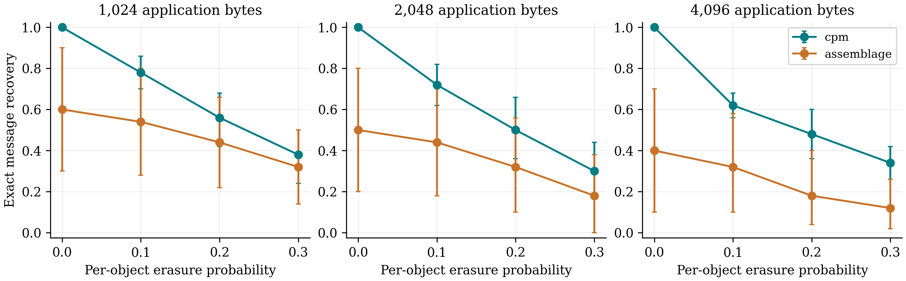

# Native local distributed-message comparison

Independent saved-packet replay verified all 1200 finite erasure traces. The experiment has ten unique source-cover/message groups per payload, not 1,200 independent messages.

Published Assemblage (FOCI 2026) uses its exact official Pulsar submodule, native PDQ discovery, Sage region ECC, church generator and RaptorQ packetization with MTU 408 and 50% additional repair packets. CPM uses its unchanged authenticated three-channel protocol. Both carry identical saved application messages of 1,024, 2,048 and 4,096 bytes. No online platform is accessed.

All native offline candidates, capacity skips, packet encoding failures, sent images, decoder exceptions and incorrect decoded packets are retained. Failed native cases are not replaced. The receiver sees actual decoded packet bytes; incorrect packets are not removed by consulting ground truth. As in upstream receive_raptor, a native decode exception among received carriers aborts the message.

Loss traces apply the same fixed iid per-object erasure law and seeds to each native system. A CPM object is one authenticated channel frame; an Assemblage object is one native image. Object sizes and counts differ and are reported; these traces are not byte-level network-loss experiments. The native images/frames are generated and decoded once, then their saved outcomes are replayed under fixed erasure patterns. CPM requires all three frames; Assemblage uses its native rateless decoder.

| Method | Bytes | Erasure probability | Unique groups | Exact recovery (95% interval) | Incorrect messages |
|---|---:|---:|---:|---|---:|
| cpm | 1024 | 0.00 | 10 | 1.000 [1.000, 1.000] | 0 |
| cpm | 1024 | 0.10 | 10 | 0.780 [0.700, 0.860] | 0 |
| cpm | 1024 | 0.20 | 10 | 0.560 [0.420, 0.680] | 0 |
| cpm | 1024 | 0.30 | 10 | 0.380 [0.240, 0.500] | 0 |
| assemblage | 1024 | 0.00 | 10 | 0.600 [0.300, 0.900] | 0 |
| assemblage | 1024 | 0.10 | 10 | 0.540 [0.280, 0.800] | 0 |
| assemblage | 1024 | 0.20 | 10 | 0.440 [0.220, 0.660] | 0 |
| assemblage | 1024 | 0.30 | 10 | 0.320 [0.140, 0.500] | 0 |
| cpm | 2048 | 0.00 | 10 | 1.000 [1.000, 1.000] | 0 |
| cpm | 2048 | 0.10 | 10 | 0.720 [0.620, 0.820] | 0 |
| cpm | 2048 | 0.20 | 10 | 0.500 [0.360, 0.660] | 0 |
| cpm | 2048 | 0.30 | 10 | 0.300 [0.180, 0.440] | 0 |
| assemblage | 2048 | 0.00 | 10 | 0.500 [0.200, 0.800] | 0 |
| assemblage | 2048 | 0.10 | 10 | 0.440 [0.180, 0.700] | 0 |
| assemblage | 2048 | 0.20 | 10 | 0.320 [0.100, 0.560] | 0 |
| assemblage | 2048 | 0.30 | 10 | 0.180 [0.000, 0.380] | 0 |
| cpm | 4096 | 0.00 | 10 | 1.000 [1.000, 1.000] | 0 |
| cpm | 4096 | 0.10 | 10 | 0.620 [0.560, 0.680] | 0 |
| cpm | 4096 | 0.20 | 10 | 0.480 [0.360, 0.600] | 0 |
| cpm | 4096 | 0.30 | 10 | 0.340 [0.260, 0.420] | 0 |
| assemblage | 4096 | 0.00 | 10 | 0.400 [0.100, 0.700] | 0 |
| assemblage | 4096 | 0.10 | 10 | 0.320 [0.100, 0.580] | 0 |
| assemblage | 4096 | 0.20 | 10 | 0.180 [0.040, 0.400] | 0 |
| assemblage | 4096 | 0.30 | 10 | 0.120 [0.020, 0.260] | 0 |

Intervals cluster the five loss seeds and repeated payload observations by the ten unique source groups. At zero loss all five seeds repeat the same intact native transmission and do not multiply the independent sample size.

native_system_cost.csv separates transmitted image/frame bytes from pre-shared offline state and hash-bank bytes. Setup, model loading, offline sampling, native send and receive costs are preserved per message. Authentication, replay resistance, rendezvous discovery and rateless loss tolerance are different services; no absent service is assigned zero cost or zero leakage.

This is a local multi-carrier comparator. It does not reproduce a deployed network, censorship, scheduling anonymity, a multi-receiver multichannel protocol, or a CPM-style CP-UNL interface. The original CPM theorem and full-public-view evidence retain their declared conditions.

## Reporting audit

The CPM rows retain 0 exactly recovered images with absolute pixel changes exceeding one level. Native synthetic carriers have no original-cover one-level distortion comparison. All observed deviations remain in the raw records and checked summary.

The native system-cost table also gives actual sent-wire totals and means over all attempts. A recognized CPM sender preflight failure contributes zero sent bytes only after checking that no authenticated frame files exist. The earlier `wire_bytes_mean` column retains its original recorded-value denominator and is labelled accordingly; the new all-attempt columns support consistent accounting without dropping failures.

## Independent interpretation check

Without added erasures, CPM recovered 30/30 messages; the recorded Assemblage artifact recovered 15/30: 6/10, 5/10 and 4/10 at 1,024, 2,048 and 4,096 bytes. This is an observation for the fixed native implementation, generator, MTU and source groups; it is not an inherent failure claim about all implementations or deployments of Assemblage.

Across 310 encoded candidate packets, 71 candidates were skipped by the original capacity gate and 18 transmitted carriers produced native receiver exceptions. The exact per-size counts and potentially overlapping message-level causes are recorded in checked_report_audit_v2/audit.json. No failed case or packet was regenerated or filtered by ground-truth correctness.

Displayed intervals are pointwise percentile bootstrap intervals over the ten recorded source groups. For ten observed successes out of ten, this resampling interval collapses to [1,1]; it does not establish 100% population reliability or exclude unobserved failures. Five zero-loss repetitions are the same intact transmission. Other loss patterns are correlated within a source group.

Runtime was recorded on the shared workstation while the already-started image study also ran. It is descriptive engineering timing, not an isolated speed benchmark or a comparison of identical protocol services. Wire-byte counts describe the actual serialized native objects; pre-shared setup state and hash-bank bytes remain separately reported.
