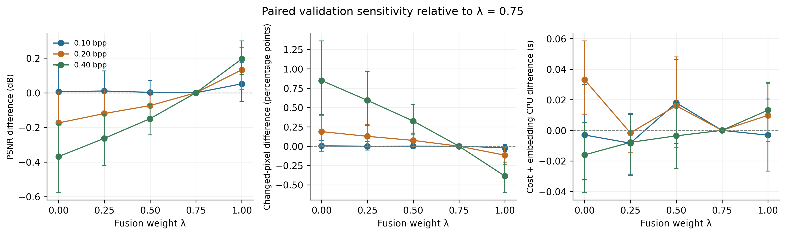

# Fusion-weight sensitivity: checked validation results

**374/375 attempts recovered the exact plaintext**. There was 1 sender preflight failure and zero incorrect accepted plaintexts. The experiment uses 25 validation covers, three payloads and five weights. Final test covers were not used. All outcomes, pairing, source hashes, receiver state and fidelity were independently checked against saved artifacts.

| Payload (bpp) | λ | Exact / attempts | Mean PSNR (dB) | Mean SSIM | Changed pixels (%) | Mean CPU (s) |
|---:|---:|---:|---:|---:|---:|---:|
| 0.10 | 0.00 | 25/25 | 65.645 | 0.999957 | 1.788 | 2.394 |
| 0.10 | 0.25 | 25/25 | 65.649 | 0.999957 | 1.784 | 2.388 |
| 0.10 | 0.50 | 25/25 | 65.642 | 0.999956 | 1.785 | 2.415 |
| 0.10 | 0.75 | 25/25 | 65.639 | 0.999953 | 1.784 | 2.397 |
| 0.10 | 1.00 | 25/25 | 65.691 | 0.999948 | 1.764 | 2.394 |
| 0.20 | 0.00 | 25/25 | 62.023 | 0.999882 | 4.123 | 2.428 |
| 0.20 | 0.25 | 25/25 | 62.077 | 0.999881 | 4.062 | 2.393 |
| 0.20 | 0.50 | 25/25 | 62.124 | 0.999880 | 4.010 | 2.411 |
| 0.20 | 0.75 | 25/25 | 62.197 | 0.999875 | 3.935 | 2.395 |
| 0.20 | 1.00 | 25/25 | 62.330 | 0.999863 | 3.818 | 2.404 |
| 0.40 | 0.00 | 24/25 | 58.326 | 0.999634 | 9.651 | 2.401 |
| 0.40 | 0.25 | 25/25 | 58.413 | 0.999650 | 9.435 | 2.407 |
| 0.40 | 0.50 | 25/25 | 58.527 | 0.999652 | 9.167 | 2.411 |
| 0.40 | 0.75 | 25/25 | 58.676 | 0.999646 | 8.842 | 2.415 |
| 0.40 | 1.00 | 25/25 | 58.871 | 0.999621 | 8.456 | 2.428 |

Fidelity and cost means above use valid trials only; all 25 attempts per setting remain in the recovery denominator. A sender preflight failure emits no stego frame, so its fidelity is undefined and cannot be replaced with a successful retry.

### Retained sender preflight failures

- Cover 2676, 0.40 bpp, λ=0.00: native STC extraction did not reproduce the masked payload during sender preflight. No frames were transmitted and no plaintext was released. The attempt was retained without retry or cover replacement.

Across the tested weights, the span of conditional-valid mean PSNR was 0.0517 dB at 0.10 bpp; 0.3066 dB at 0.20 bpp; 0.5452 dB at 0.40 bpp. These describe this validation panel and one fixed message/seed per cover/payload.

## Paired fidelity comparison with the retained 0.75 setting

Positive PSNR difference favours the alternative on PSNR; negative changed-pixel difference means fewer modifications. These are fidelity diagnostics, not detector results. The table gives mean PSNR differences and unadjusted 95% cover-paired bootstrap intervals.

| Payload | λ | Paired covers | ΔPSNR versus 0.75 (dB) | 95% paired interval |
|---:|---:|---:|---:|---:|
| 0.10 | 0.00 | 25 | +0.0061 | [-0.1621, +0.1584] |
| 0.10 | 0.25 | 25 | +0.0101 | [-0.1215, +0.1253] |
| 0.10 | 0.50 | 25 | +0.0023 | [-0.0761, +0.0685] |
| 0.10 | 1.00 | 25 | +0.0517 | [-0.0511, +0.1720] |
| 0.20 | 0.00 | 25 | -0.1741 | [-0.3733, +0.0048] |
| 0.20 | 0.25 | 25 | -0.1201 | [-0.2741, +0.0164] |
| 0.20 | 0.50 | 25 | -0.0738 | [-0.1667, +0.0067] |
| 0.20 | 1.00 | 25 | +0.1325 | [+0.0198, +0.2627] |
| 0.40 | 0.00 | 24 | -0.3684 | [-0.5754, -0.1836] |
| 0.40 | 0.25 | 25 | -0.2632 | [-0.4223, -0.1251] |
| 0.40 | 0.50 | 25 | -0.1495 | [-0.2429, -0.0689] |
| 0.40 | 1.00 | 25 | +0.1955 | [+0.1067, +0.2996] |

## Interpretation and reviewer coverage

The lambda=1 endpoint had the highest mean PSNR at all three payloads: approximately 0.052, 0.132 and 0.196 dB above 0.75, respectively. Its mean SSIM was slightly lower than 0.75 at each payload. Thus 0.75 was not the PSNR-maximising setting in this panel. These small SSIM differences do not by themselves establish a perceptually important trade-off or justify security superiority. At 0.75 all 75 attempts recovered exactly; the one sender preflight failure occurred at 0 with 0.40 bpp.

This supplies the requested validation-only sensitivity evidence for explaining the fixed fusion weight in Reviewer 4, comment 4, and helps quantify the component trade-off. It is a new revision-stage sensitivity panel, not evidence of how the historical weight was originally selected. The all-attempt recovery counts and measured fidelity/cost differences should be reported directly; do not describe 0.75 as the best setting unless the stated objective and evidence support that claim. No detector was trained or scored, so these data do not determine a security-optimal weight. The current manuscript setting has not been changed by this experiment.

The five variants share all message/context/seed inputs within each cover/payload. They represent counterfactual variants with separate receiver states. Lambda also propagates through the original residual-feature construction. Endpoints remain internal CPM pipeline variants, not standalone published MiPOD or S-UNIWARD comparators.

Three concurrent CPU cases ran with one thread per process. Mean CPU above covers cost construction plus embedding; it excludes process startup, preflight extraction and transport/authentication. Wall time and actual serialized bytes are retained in the raw results/summary. A single timing observation per variant on a shared workstation supports descriptive cost sensitivity; it does not support a hardware-independent speed ranking.

The 10,000 bootstrap draws resample all 25 attempted cover IDs jointly across weights and payloads. Undefined fidelity is omitted within a group; each paired contrast uses covers valid under both weights. Paired sample sizes are reported explicitly. Thus fidelity inference is conditional on valid trials, while recovery always counts all attempts. Pairing and within-cover dependence are preserved. Intervals are descriptive and unadjusted for multiple comparisons. This small validation panel does not replace held-out detector evaluation, cross-channel linkage tests or matched published-baseline comparisons.

## Reproduction

`source/README.md` and `run_config.json` give the full design; `source/source_adaptation.diff` records the bounded weight/timing adapter. `development_validation.json` confirms that the new worker at 0.75 reproduced a prior training fixture byte for byte. `cover_manifest.csv`/`case_manifest.json` fix all validation inputs and order. `trial_results.jsonl`, `inputs/` and `trials/` retain every attempt. `sensitivity_summary.csv`, `paired_differences_vs075.csv` and `verified_summary.json` contain all group/paired statistics. PNG and SVG figures use the same verified numbers.
