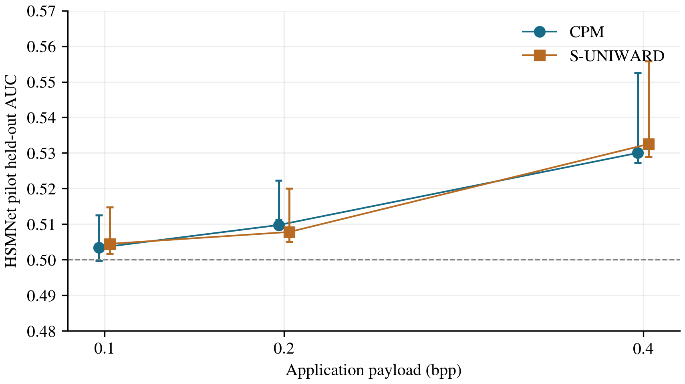

# Short HSMNet detectability pilot

Fixed short neural-detector study on 300 fresh development covers, disjoint from the SRM pilot and taken exclusively from the full study training pool. The full SRM/HSMNet study remains paused; its validation/test covers are untouched. Saved CPM and recorded S-UNIWARD images are reused without new embedding.

Official HSMNet architecture, native 512x512 grayscale inputs in [0,255], paired batch size2, random paired D4 training augmentation. Fixed 200/40/60 source-cover split; 20 epochs and seeds801/802 per payload. One equal-method cycling mixture detector per payload/seed; the same observer scores both methods. Adamax lr0.001, milestones12/17, gamma0.1; best joint validation cross-entropy at epochs1/5/10/15/20. Only common score orientation/threshold uses validation. This is a reduced training budget from random initialization, not reproduction of published HSMNet scores.

| Method | bpp | Test groups | AUC [pointwise 95% CI] | Balanced accuracy |
|---|---:|---:|---|---:|
| cpm | 0.10 | 60 | 0.5033 [0.4997, 0.5125] | 0.5000 |
| suniward | 0.10 | 60 | 0.5044 [0.5017, 0.5147] | 0.5000 |
| cpm | 0.20 | 60 | 0.5097 [0.5111, 0.5222] | 0.5000 |
| suniward | 0.20 | 60 | 0.5078 [0.5050, 0.5200] | 0.5000 |
| cpm | 0.40 | 60 | 0.5300 [0.5272, 0.5525] | 0.5500 |
| suniward | 0.40 | 60 | 0.5325 [0.5289, 0.5558] | 0.5500 |

| bpp | CPM minus S-UNIWARD AUC | Three-payload adjusted interval |
|---:|---:|---|
| 0.10 | -0.0011 | [-0.0128, 0.0081] |
| 0.20 | 0.0019 | [-0.0031, 0.0142] |
| 0.40 | -0.0025 | [-0.0061, -0.0003] |

All 6 selected checkpoint prediction sets reproduced. Source-cover bootstrap uses 2000 shared draws; common-valid counts and all 1800 saved records are retained in cohort_accounting.json. No failed case was retried or replaced. The synthetic texture control checks only strong artificial-signal sensitivity.

Training/validation histories and selected epochs remain saved. Near-chance scores in this small, short, randomly initialized neural run may reflect insufficient training and cannot establish security, equivalence or performance of a fully trained HSMNet. Pilot results must not change the frozen full study. The HSMNet and SRM pilots have different cohorts and budgets; do not pool their scores or claim a paired cross-detector ranking.

## Checked interpretation and report continuation

Observed AUCs remain close to chance: CPM 0.5033 / 0.5097 / 0.5300 and S-UNIWARD 0.5044 / 0.5078 / 0.5325. These are limited, weak-observer results, not evidence that the implementation resists a sufficiently trained neural detector. Validation AUCs are only 0.5053 / 0.5100 / 0.5316. At 0.10/0.20 bpp, final training accuracies are 0.4950-0.5275 and losses remain near 0.69. At 0.40 bpp, final training accuracy improves to 0.6325/0.6625, but validation loss worsens to 2.6254/10.2466; the predeclared rule selects early checkpoints at epochs 5/1. Thus this pilot demonstrates poor native generalization, including high-payload overfitting or calibration instability, rather than a successful strong-detector test. The successful synthetic texture control does not establish native training convergence.

All secondary panels and contrasts are retained. The 0.40-bpp adjusted CPM-minus-S-UNIWARD interval excludes zero, favouring CPM by a very small observed AUC difference of 0.0025 in this specific pilot. The other two adjusted contrasts include zero. This small difference does not establish practical or general superiority. Five pointwise percentile intervals exclude 0.5: CPM at 0.20/0.40 and S-UNIWARD at all three payloads; do not state that all intervals contain chance.

Uncertainty is conditional on these fixed trained models and this development cohort. Source-cover resampling preserves the paired cover/stego dependence. Its percentile interval can be asymmetric and need not contain the original estimate (as for CPM at 0.20 bpp). Endpoints were independently reproduced from saved scores and are drawn directly, without clipping or widening. These intervals do not represent training-seed variability or population-wide security.

The original pipeline failed only when Matplotlib rejected a negative relative error-bar length: the CPM 0.20-bpp percentile lower endpoint exceeds its point estimate. report_repair_v1 draws each actual interval endpoint directly and exports this report from unchanged tables. All original sources, failed logs/status, models, histories, selection, test predictions, metric tables and verification evidence are preserved with hashes. No training, selection or held-out scoring was repeated.

### Native training diagnostics

| bpp | Seed | Selected epoch | Selected validation loss | Final training loss | Final training accuracy |
|---:|---:|---:|---:|---:|---:|
| 0.10 | 801 | 10 | 0.693197 | 0.695779 | 0.5275 |
| 0.10 | 802 | 20 | 0.693157 | 0.695751 | 0.5100 |
| 0.20 | 801 | 5 | 0.693228 | 0.697250 | 0.5200 |
| 0.20 | 802 | 5 | 0.693140 | 0.698374 | 0.4950 |
| 0.40 | 801 | 5 | 0.691445 | 0.627502 | 0.6325 |
| 0.40 | 802 | 1 | 0.693087 | 0.587703 | 0.6625 |
