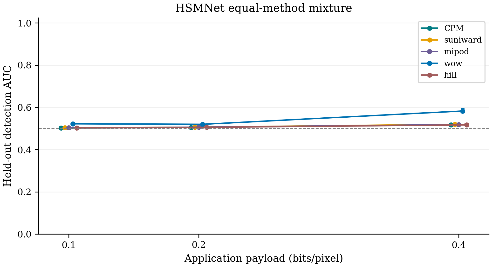
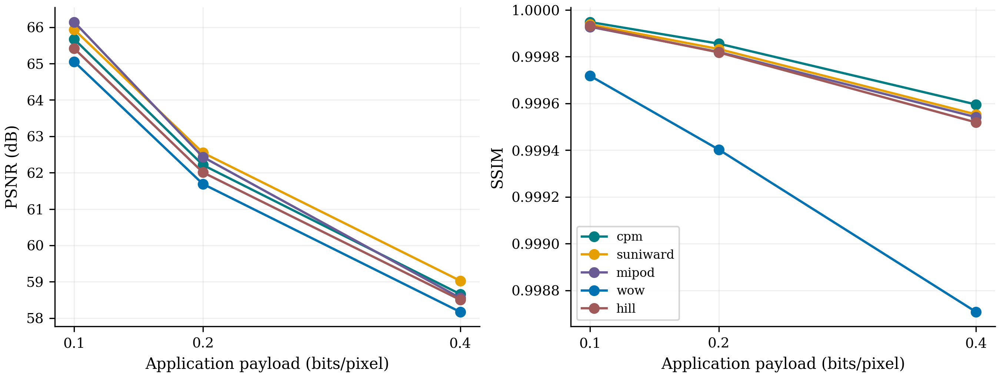

# HSMNet matched image comparison

Independent saved-artifact verification passed for 6 selected checkpoints.

Fixed BOSSBase panel: 700 training / 200 validation / 300 test covers; native 512 × 512 grayscale. Three application payloads: 0.10, 0.20 and 0.40 bpp. All source versions, failed attempts, symmetric common-valid exclusions and model choices are retained.

Only HSMNet is evaluated in this continuation, using the same equal-method mixture observer for all methods at each payload; the original SRM job remains paused. HSMNet is the published architecture with a declared bounded training budget, not a reproduction of its original paper scores. Scores describe these image-content wardens and do not estimate IND-STEGO-MC or CP-UNL security bounds.

The classical images are reused from the original study and labelled by their recorded implementations. In particular, the local MiPOD variance estimator is an approximation; these rows must not be described as certified reference-code results. Historical recovery is originally reported, whereas the separate 450-attempt fresh panel has saved known messages and independent native extraction.

## Held-out detection

| Detector | Method | bpp | Covers | AUC (95% interval) | Balanced accuracy |
|---|---|---:|---:|---|---:|
| HSMNet equal-method mixture | cpm | 0.10 | 288 | 0.5024 [0.5027, 0.5043] | 0.5035 |
| HSMNet equal-method mixture | suniward | 0.10 | 288 | 0.5032 [0.5035, 0.5054] | 0.5035 |
| HSMNet equal-method mixture | mipod | 0.10 | 288 | 0.5033 [0.5039, 0.5055] | 0.5035 |
| HSMNet equal-method mixture | wow | 0.10 | 288 | 0.5224 [0.5215, 0.5270] | 0.5104 |
| HSMNet equal-method mixture | hill | 0.10 | 288 | 0.5025 [0.5027, 0.5044] | 0.5035 |
| HSMNet equal-method mixture | cpm | 0.20 | 289 | 0.5054 [0.5058, 0.5080] | 0.5035 |
| HSMNet equal-method mixture | suniward | 0.20 | 289 | 0.5063 [0.5066, 0.5090] | 0.5052 |
| HSMNet equal-method mixture | mipod | 0.20 | 289 | 0.5064 [0.5069, 0.5091] | 0.5069 |
| HSMNet equal-method mixture | wow | 0.20 | 289 | 0.5201 [0.5193, 0.5245] | 0.5121 |
| HSMNet equal-method mixture | hill | 0.20 | 289 | 0.5057 [0.5059, 0.5082] | 0.5035 |
| HSMNet equal-method mixture | cpm | 0.40 | 294 | 0.5170 [0.5159, 0.5217] | 0.5051 |
| HSMNet equal-method mixture | suniward | 0.40 | 294 | 0.5199 [0.5185, 0.5248] | 0.5051 |
| HSMNet equal-method mixture | mipod | 0.40 | 294 | 0.5186 [0.5174, 0.5236] | 0.5051 |
| HSMNet equal-method mixture | wow | 0.40 | 294 | 0.5829 [0.5757, 0.5934] | 0.5493 |
| HSMNet equal-method mixture | hill | 0.40 | 294 | 0.5172 [0.5159, 0.5222] | 0.5051 |

Paired CPM-minus-baseline AUC differences and family-adjusted intervals are in `auc_paired_contrasts.csv`; positive differences indicate easier detection of CPM by the tested observer. Lower AUC is favourable only relative to the fixed, validation-oriented observer. No universal superiority claim is inferred.

## Fidelity, recovery and cost

Fidelity uses identical test covers and common-valid cover/payload blocks for every method. `paired_fidelity.csv` and `fidelity_contrasts.csv` include PSNR, SSIM and modified pixels with cover-cluster uncertainty. All attempts remain in the separate accounting.

Fresh sequential development panel: 450 attempts, 446 exact recoveries. `fresh_recovery_runtime.csv` separates core embedding, process wall time, extraction, carrier bytes and actual CPM serialized frame bytes. It compares 30 fixed development covers across all five methods and payloads.

The single-carrier classical primitives do not implement CPM authentication, replay handling or public parameter channels. Missing protocol-wire and cross-channel linkage quantities are not applicable, never zero. Timing includes local desktop contention and is an engineering observation. Existing completed full-view CP-UNL results stay separate.

Generative and distributed-carrier comparisons are a separate native-format panel; they are not mixed into this BOSSBase AUC table.

## Reporting audit

Images with an absolute pixel change exceeding one level remain retained. Counts in the main image panel, by method: cpm: 0, suniward: 0, mipod: 0, wow: 0, hill: 1. Fresh development panel: cpm: 0, suniward: 0, mipod: 0, wow: 0, hill: 0. These observations do not imply incorrect recovered plaintext.

Fresh core-time comparisons consistently use cost-map computation plus native STC embedding and exclude image serialization. For the baseline workers this is derived from their separately saved `cost_sec + stc_sec`; the original raw `core_sec` also included the image save. Raw measurements, scientific settings, outcomes, model choices and detector results are unchanged. `report_quality_v1/provenance.json` preserves the original table and the correction.
