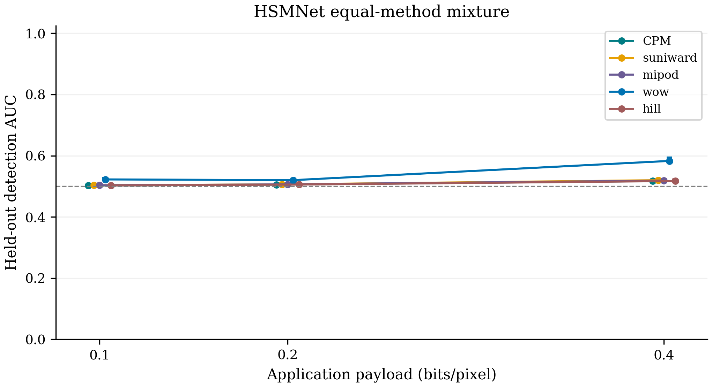
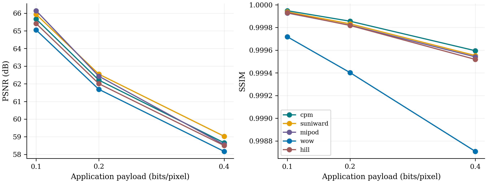

# HSMNet matched image comparison

Independent saved-artifact verification passed for 6 selected checkpoints.

Fixed BOSSBase panel: 700 training / 200 validation / 300 test covers; native 512 × 512 grayscale. Three application payloads: 0.10, 0.20 and 0.40 bpp. All source versions, failed attempts, symmetric common-valid exclusions and model choices are retained.

Only HSMNet is evaluated in this continuation, using the same equal-method mixture observer for all methods at each payload; the original SRM job remains paused. HSMNet is the published architecture with a declared bounded training budget, not a reproduction of its original paper scores. Scores describe these image-content wardens and do not estimate IND-STEGO-MC or CP-UNL security bounds.

The classical images are reused from the original study and labelled by their recorded implementations. In particular, the local MiPOD variance estimator is an approximation; these rows must not be described as certified reference-code results. Historical recovery is originally reported, whereas the separate 450-attempt fresh panel has saved known messages and independent native extraction.

## Held-out detection

| Detector | Method | bpp | Covers | AUC (95% interval) | Balanced accuracy |
|---|---|---:|---:|---|---:|
| HSMNet equal-method mixture | cpm | 0.10 | 288 | 0.5024 [0.5027, 0.5043] | 0.5035 |
| HSMNet equal-method mixture | suniward | 0.10 | 288 | 0.5032 [0.5035, 0.5054] | 0.5035 |
| HSMNet equal-method mixture | mipod | 0.10 | 288 | 0.5033 [0.5039, 0.5055] | 0.5035 |
| HSMNet equal-method mixture | wow | 0.10 | 288 | 0.5224 [0.5215, 0.5270] | 0.5104 |
| HSMNet equal-method mixture | hill | 0.10 | 288 | 0.5025 [0.5027, 0.5044] | 0.5035 |
| HSMNet equal-method mixture | cpm | 0.20 | 289 | 0.5054 [0.5058, 0.5080] | 0.5035 |
| HSMNet equal-method mixture | suniward | 0.20 | 289 | 0.5063 [0.5066, 0.5090] | 0.5052 |
| HSMNet equal-method mixture | mipod | 0.20 | 289 | 0.5064 [0.5069, 0.5091] | 0.5069 |
| HSMNet equal-method mixture | wow | 0.20 | 289 | 0.5201 [0.5193, 0.5245] | 0.5121 |
| HSMNet equal-method mixture | hill | 0.20 | 289 | 0.5057 [0.5059, 0.5082] | 0.5035 |
| HSMNet equal-method mixture | cpm | 0.40 | 294 | 0.5170 [0.5159, 0.5217] | 0.5051 |
| HSMNet equal-method mixture | suniward | 0.40 | 294 | 0.5199 [0.5185, 0.5248] | 0.5051 |
| HSMNet equal-method mixture | mipod | 0.40 | 294 | 0.5186 [0.5174, 0.5236] | 0.5051 |
| HSMNet equal-method mixture | wow | 0.40 | 294 | 0.5829 [0.5757, 0.5934] | 0.5493 |
| HSMNet equal-method mixture | hill | 0.40 | 294 | 0.5172 [0.5159, 0.5222] | 0.5051 |

Paired CPM-minus-baseline AUC differences and family-adjusted intervals are in `auc_paired_contrasts.csv`; positive differences indicate easier detection of CPM by the tested observer. Lower AUC is favourable only relative to the fixed, validation-oriented observer. No universal superiority claim is inferred.

## Fidelity, recovery and cost

Fidelity uses identical test covers and common-valid cover/payload blocks for every method. `paired_fidelity.csv` and `fidelity_contrasts.csv` include PSNR, SSIM and modified pixels with cover-cluster uncertainty. All attempts remain in the separate accounting.

Fresh sequential development panel: 450 attempts, 446 exact recoveries. `fresh_recovery_runtime.csv` separates core embedding, process wall time, extraction, carrier bytes and actual CPM serialized frame bytes. It compares 30 fixed development covers across all five methods and payloads.

The single-carrier classical primitives do not implement CPM authentication, replay handling or public parameter channels. Missing protocol-wire and cross-channel linkage quantities are not applicable, never zero. Timing includes local desktop contention and is an engineering observation. Existing completed full-view CP-UNL results stay separate.

Generative and distributed-carrier comparisons are a separate native-format panel; they are not mixed into this BOSSBase AUC table.

## Reporting audit

Images with an absolute pixel change exceeding one level remain retained. Counts in the main image panel, by method: cpm: 0, suniward: 0, mipod: 0, wow: 0, hill: 1. Fresh development panel: cpm: 0, suniward: 0, mipod: 0, wow: 0, hill: 0. These observations do not imply incorrect recovered plaintext.

Fresh core-time comparisons consistently use cost-map computation plus native STC embedding and exclude image serialization. For the baseline workers this is derived from their separately saved `cost_sec + stc_sec`; the original raw `core_sec` also included the image save. Raw measurements, scientific settings, outcomes, model choices and detector results are unchanged. `report_quality_v1/provenance.json` preserves the original table and the correction.

## Independently checked findings

All six fixed HSMNet models completed the originally specified 100 epochs with seeds801/802; the original five-method mixture, source partitions and validation-only selection remained unchanged. No training-quality diagnosis was performed. A single frozen held-out scoring pass produced15 method/payload panels, and the predeclared verifier reproduced all6 selected seed-checkpoint predictions and all15 ensembles. A separate saved-score audit independently reproduced all15 AUC/pointwise interval panels,12 adjusted AUC contrasts,45 fidelity mean/interval checks,36 fidelity contrasts and15 fresh recovery/timing summaries. Both local figures were inspected.

Observed HSMNet AUCs favour CPM over the recorded WOW implementation at all three payloads. Adjusted CPM-minus-WOW differences are -0.0200 [-0.0249,-0.0169], -0.0147 [-0.0186,-0.0119] and -0.0659 [-0.0789,-0.0548]. The adjusted comparisons also favour CPM over the recorded local MiPOD approximation at all three payloads, although those absolute AUC differences are only0.0009/0.0009/0.0016. The S-UNIWARD contrast favours CPM at0.40bpp only (difference-0.0029, interval[-0.0042,-0.0018]); its lower-payload intervals and all three HILL intervals include zero. Seven of12 adjusted contrasts favour CPM; none favour a baseline, and five do not establish a difference. These findings apply to the fixed shared HSMNet observer, recorded implementations and declared cohort, not all possible wardens or general superiority.

CPM point estimates0.5024/0.5054/0.5170 are numerically close to0.5, but all15 pointwise conditional cover-bootstrap intervals exclude0.5. Do not describe the results as no detectable difference from chance. The percentile intervals condition on the saved models and common-valid cover blocks, preserve paired cover/stego dependence and omit training-variability uncertainty. They can be asymmetric and need not contain the original estimate; this occurs for some low-payload panels and is retained without clipping or widening. Independently recomputed exact endpoints agree with the tables. Small conditional differences do not establish equivalence, negligible leakage or a cryptographic security bound.

Fidelity and timing remain mixed. CPM has the highest mean SSIM at all three payloads in the common-valid table. S-UNIWARD has higher mean PSNR at all three; the local MiPOD approximation has higher PSNR at0.10/0.20, while CPM has higher PSNR at0.40. Fresh exact-recovery-conditioned core embedding time is approximately2.30s for CPM,0.90-0.91s for S-UNIWARD/WOW,0.54-0.55s for HILL and3.24-3.25s for the local MiPOD approximation. These shared-workstation primitive costs have different protocol services and do not establish overall system superiority.

### All-attempt and common-valid accounting

The 1,200 source covers retain their original700/200/300 source-level split. Five-method common-valid training/validation/test counts are681/195/288 at0.10bpp,684/196/289 at0.20 and671/195/294 at0.40. Detector/fidelity comparisons therefore use288/289/294 held-out covers respectively. All18,000 saved method attempts remain, including111 invalid image records.

| Recorded method | Main attempted | Main valid images | Independently recovered CPM payloads | Fresh known-message exact / attempted |
|---|---:|---:|---:|---:|
| CPM revised native protocol | 3600 | 3595 | 3595 | 90/90 |
| S-UNIWARD local implementation | 3600 | 3600 | Not established for historical messages | 90/90 |
| MiPOD local variance approximation | 3600 | 3600 | Not established for historical messages | 90/90 |
| WOW local implementation | 3600 | 3565 | Not established for historical messages | 90/90 |
| HILL local implementation | 3600 | 3529 | Not established for historical messages | 86/90 |

The four fresh failures are HILL cases; the five main revised CPM failures and all baseline invalid records remain retained without replacement. Historical baseline valid-image counts do not certify independent recovery of their original unknown messages. The separate fresh450-case panel supplies the known-byte checks. The one main-panel HILL pixel deviation remains reported above.

### Operational provenance

The original process was interrupted during an uncheckpointed portion of epoch27 of the first model. Versioned continuation resume_20261021_v1 restored the saved epoch26 model/Adamax/scheduler and reconstructed fixed-seed RNG calls without native forward/gradient replay; completed epochs1-26 and all original artifacts remain backed up. Only uncheckpointed partial-epoch updates were lost. Subsequent last checkpoints saved RNG state atomically. Architecture, data,100epoch budget, optimiser/schedule, augmentation, selection and uncertainty settings remained unchanged. No held-out selection was repeated. Reporting QA and this final interpretation/accounting update preserve original reports and before/after hashes. The original SRM continuation remains paused, and neither short pilot was modified.
