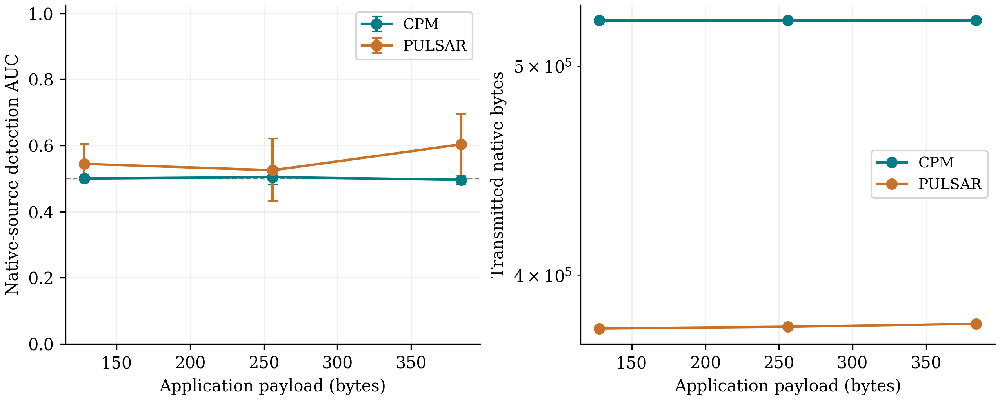

# Native generative comparison: Pulsar and CPM

All 24 selected checkpoint prediction sets passed independent reproduction; native image hashes and exact recovered byte strings were checked.

Fixed panel: 200 new source groups (100 training / 40 validation / 60 test) at 128, 256 and 384 application bytes. Each group pairs a BOSSBase cover for CPM with a native Google church DDPM seed for Pulsar. The common quantity is application bytes, not bpp or original-cover PSNR. CPM uses 512×512 grayscale PGM with three authenticated frames. Pulsar keeps 256×256 RGB 16-bit PNG, its native 50-step sampler and original region ECC.

Each detector is trained against the appropriate benign source: original natural covers for CPM and the same unmodified sampler output for Pulsar, serialized identically to the stego images. Fixed native-precision content features are shared; no secret key, mask, seed, source-cover pair or verification result is supplied as a feature. Family and tuning choices use validation only. A common family is selected across the two sources at each payload. This is a bounded content test, not a full-view proof or a reproduction of published detector results.

| Method | Bytes | Attempts | Exact | Capacity failures | Other failures | Mean native transmitted bytes |
|---|---:|---:|---:|---:|---:|---:|
| cpm | 128 | 200 | 200 | 0 | 0 | 525066.0 |
| pulsar | 128 | 200 | 185 | 7 | 8 | 378098.7351351351 |
| cpm | 256 | 200 | 200 | 0 | 0 | 525066.0 |
| pulsar | 256 | 200 | 180 | 8 | 12 | 378831.23333333334 |
| cpm | 384 | 200 | 200 | 0 | 0 | 525066.0 |
| pulsar | 384 | 200 | 153 | 39 | 8 | 380018.53594771243 |

| Method | Bytes | Primary family | Test groups | AUC (95% interval) |
|---|---:|---|---:|---|
| cpm | 128 | logistic | 55 | 0.5002 [0.4883, 0.5112] |
| pulsar | 128 | logistic | 55 | 0.5445 [0.4889, 0.6049] |
| cpm | 256 | extra_trees | 53 | 0.5043 [0.4818, 0.5292] |
| pulsar | 256 | extra_trees | 53 | 0.5251 [0.4330, 0.6214] |
| cpm | 384 | logistic | 45 | 0.4963 [0.4819, 0.5090] |
| pulsar | 384 | logistic | 45 | 0.6035 [0.5091, 0.6962] |

All capacity and native decoder failures remain in all-attempt counts. Detector panels condition symmetrically on both native methods recovering; insufficient fixed minimum counts make a panel not evaluable. No failed group is replaced. Primary AUC contrasts have three-payload adjusted intervals; secondary families are retained in native_detectability.csv.

Raw byte cost compares native serialized services, which differ: CPM includes two public objects, JSON/base64 frames, authentication and freshness context; Pulsar supplies a native image primitive and shared model/key/seed context. Runtime separates sampler/region setup, encoding, decoding and process/model-loading overhead in raw per-case metrics. These do not establish equivalent protocol protection or universal efficiency superiority.

Original-cover PSNR/SSIM apply only to CPM in native_recovery_cost.csv; they are not assigned to synthetic Pulsar carriers. Cross-channel CP-UNL is not defined for this single-carrier interface and is not reported as zero. The earlier CPM full-public-view study remains separate.

## Reporting audit

The CPM rows retain 0 exactly recovered images with absolute pixel changes exceeding one level. Native synthetic carriers have no original-cover one-level distortion comparison. All observed deviations remain in the raw records and checked summary.

The mean transmitted-byte and timing summaries for the native generative panel condition on exact recovery; their denominators are the explicitly reported exact-recovery counts. All capacity and recovery failures remain in the all-attempt table. These means must not be described as all-attempt communication cost.
