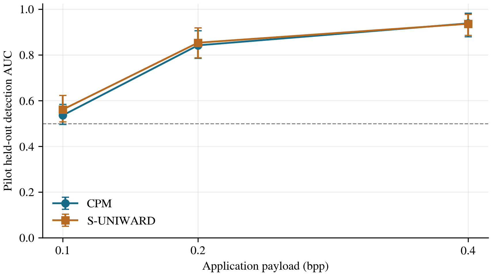

# Short revised-CPM detectability pilot

Separate SRM-only development pilot. The full SRM/HSMNet experiment remains paused. No new image embedding or HSMNet training occurred. All 160 covers come from the full study training pool; its original validation/test covers are untouched. The fixed-seed cohort is drawn from training covers with cached, valid 0.10-bpp CPM/S-UNIWARD features for speed. This cache-availability cohort is not a fresh random sample of the complete BOSSBase population.

Fixed 100/20/40 pilot training/validation/test split by cover identity. CPM and the recorded S-UNIWARD implementation use the same common-valid groups at 0.10/0.20/0.40 bpp. Full 34,671-dimensional SRM, 20 FLD learners, fixed subspace 128 and seeds 801/802. Only score orientation and threshold use validation; pilot test is used once. All failures remain in cohort accounting.

| Method | bpp | Test groups | AUC [pointwise 95% CI] | Balanced accuracy |
|---|---:|---:|---|---:|
| cpm | 0.10 | 40 | 0.5359 [0.4953, 0.5834] | 0.5500 |
| suniward | 0.10 | 40 | 0.5613 [0.5072, 0.6228] | 0.5625 |
| cpm | 0.20 | 39 | 0.8422 [0.7856, 0.9063] | 0.7308 |
| suniward | 0.20 | 39 | 0.8537 [0.7874, 0.9181] | 0.7564 |
| cpm | 0.40 | 40 | 0.9384 [0.8791, 0.9828] | 0.8625 |
| suniward | 0.40 | 40 | 0.9366 [0.8856, 0.9778] | 0.8625 |

| bpp | CPM minus S-UNIWARD AUC | Three-payload adjusted interval |
|---:|---:|---|
| 0.10 | -0.0253 | [-0.0804, 0.0312] |
| 0.20 | -0.0115 | [-0.0744, 0.0544] |
| 0.40 | 0.0019 | [-0.0381, 0.0457] |

All 12 saved checkpoint predictions reproduced. Source-group uncertainty uses 2000 shared multinomial draws over the forty pilot test covers. Counts after symmetric exclusions are in cohort_accounting.json. Validity of historical S-UNIWARD images is source-recorded; this pilot does not independently reconstruct historical payload bytes.

The synthetic planted-feature control tests pipeline sensitivity to a strong artificial shift; it does not establish native detector completeness. The pilot is small, development-only evidence with a reduced fixed training budget. Near-chance AUC is not proof of security or equivalence, and a method difference needs its paired adjusted interval. Pilot results must not change the frozen full-study sample, features, training budget or selection rules.

## Checked interpretation

CPM has near-chance observed SRM AUC at 0.10 bpp (0.5359, pointwise interval 0.4953–0.5834). This is encouraging low-payload evidence for this finite observer, not an equivalence result. At 0.20 and 0.40 bpp, CPM AUC rises to 0.8422 and 0.9384, with intervals clearly above chance: the tested images have a substantial detectable footprint.

All three adjusted CPM-minus-S-UNIWARD AUC intervals include zero. The pilot therefore does not demonstrate a detectability advantage over the recorded S-UNIWARD baseline. These are small internal development test cohorts of 40/39/40 cover identities, with the fixed reduced SRM budget; they do not supply HSMNet or final full-study evidence.

The independent checked review reproduced all six AUC/pointwise intervals and all three adjusted contrasts using a separate weighted sorted-score ROC calculation from saved predictions. Frozen source, input and feature hashes and all 960 method records were checked; no training, selection or native trial was repeated.

